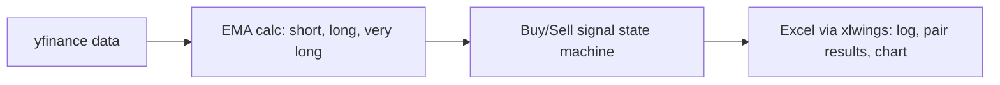

# EMA Paper Trading Bot

Python scripts that backtest and live paper-trade an EMA-crossover strategy on NSE stocks using Yahoo Finance data, with Excel (xlwings) as the control panel and live dashboard.

## What it does
- Picks promising stocks by the behaviour of a very-long-period EMA over a chosen interval and time period (`to_select_top_EMA_Stock.py`).
- Searches for the best short/long EMA pair for a given stock and period by brute force (`cheak_bext_EMA_pair.py`: loops short in 1..49, long < short range, records compounded profit, trade count and ratio into an Excel sheet).
- Runs a backtest + live paper-trading loop that buys and sells on EMA crossover signals and writes every tick (price, short/long/very-long EMA, action, state) into an Excel sheet that carries a chart (`live_paper_trading.py`, `all_in_1_work.py`).
- `mod.py` is an experimental variant that imports TA-Lib indicators and reads an `INFY.csv` workbook (latest commit: "using TA lib, while simplify the workflow").

## Design
Small class hierarchy shared across scripts: `Base` (price history) -> `EmaProcces` (short / long / very-long EMA update) -> `BuySell` (signal state machine, profit list) -> `InformationToStore` (writes rows to Excel). Trades are paper only; no broker API is called anywhere in the code.



## Tech stack
Python, yfinance, pandas, xlwings (needs Microsoft Excel), rich, statistics/math; TA-Lib in `mod.py`.

## Structure
```
all_in_1_work.py            # combined workflow (pair + signals)
live_paper_trading.py       # backtest + live paper trading
cheak_bext_EMA_pair.py      # EMA pair optimisation
to_select_top_EMA_Stock.py  # stock selection (reads up to ~200 symbols from sheet 1)
mod.py                      # TA-Lib experiment
information.xlsx            # control workbook (sheets: stock list, per-tick log, pair results) + chart
Readme.txt                  # original notes
```

## Setup
There is no requirements file. Install what the imports need:
```bash
pip install yfinance pandas xlwings rich
# optional for mod.py: TA-Lib
```
Requires Excel on Windows/macOS (xlwings opens `information.xlsx` at import time). Edit the company/interval/period variables near the bottom of each script, then `python <script>.py`. No API keys or env vars are required.

## Limitations
- Scripts are largely copy-pasted copies of the same classes; no shared module, tests or requirements.
- Hard dependency on a desktop Excel instance; inputs are edited in code/sheets.
- No transaction costs, slippage or risk management; no results are documented in the repo.
- Paper trading only; not financial advice.
